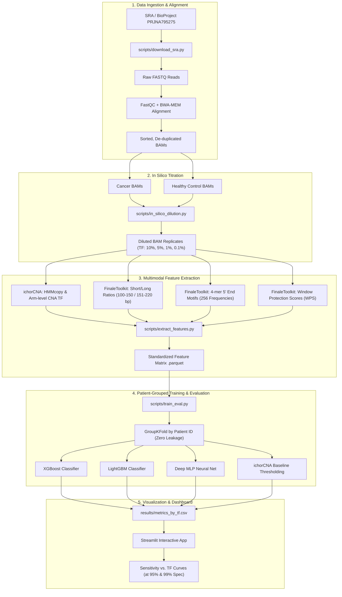

# Tumor-Fraction-Aware AI for Early Multi-Cancer Detection from Liquid Biopsy

[](https://www.python.org/downloads/release/python-3100/)
[](https://snakemake.readthedocs.io)
[](https://opensource.org/licenses/MIT)

An end-to-end computational framework and machine learning pipeline designed to rescue low-tumor-fraction sensitivity in cell-free DNA (cfDNA) liquid biopsy for multi-cancer early detection (MCED).

---

## 1. Problem Statement & Motivation

Early detection of solid tumors prior to metastasis remains the most effective intervention to decrease cancer mortality. Liquid biopsy analyzing circulating cell-free DNA (cfDNA) via low-pass whole-genome sequencing (sWGS, ~1–2x depth) offers a cost-effective, non-invasive modality for population-scale screening.

However, clinical translation faces a steep biological bottleneck:
- **Late-Stage vs. Early-Stage cfDNA Biology:** In advanced/metastatic disease (Stages III–IV), circulating tumor fraction ($TF$) typically exceeds $5\%\text{--}10\%$, where somatic copy number alterations (SCNAs) are readily distinguishable from sequencing noise.
- **The Low Tumor-Fraction Sensitivity Gap:** In early-stage solid tumors (Stages I–II), the circulating tumor fraction frequently plunges below $1.0\%$, often residing between $0.05\%\text{--}0.5\%$.
- **Failure Mode of Classical sWGS Algorithms:** Classical tools such as **ichorCNA** infer tumor fraction by fitting hidden Markov models (HMM) to bin-level copy number deviations. When $TF < 3\%$, the SCNA signal-to-noise ratio collapses, yielding false negatives or defaulting to baseline zero-TF estimates.

### Our Solution
This project develops a **Tumor-Fraction-Aware Machine Learning Framework** that combines:
1. **Multimodal Fragmentomic Signatures:** Short-to-long fragment length ratios (DELFI profiles), 4-mer 5' end motif frequencies, cleavage site protection scores (WPS), and nucleosome repeat length distortions.
2. **Systematic In Silico Titration:** Rigorous read-level blending of cancer and healthy BAM files across target fractions ($10\%$, $5\%$, $1\%$, and $0.1\%$) with exact library size standardization.
3. **Leakage-Free Cross-Validation:** Patient-level grouped splits (`GroupKFold`) ensuring that no reads, patient-specific germline variants, or diluted replicates from the same donor leak into validation folds.
4. **TF-Conditioned Inference:** Model architectures benchmarked directly against `ichorCNA` to measure sensitivity recovery at fixed clinically viable specificities ($95\%$ and $99\%$).

---

## 2. Pipeline Architecture



---

## 3. Supported Cohorts & Datasets

| Dataset Identifier | Biological Focus | Modality & Coverage | Access Protocol |
| :--- | :--- | :--- | :--- |
| **PRJNA795275** (`GSE126044`) | DELFI multi-cancer cohort (7 cancer types + healthy controls) | Low-pass sWGS (~1–2x), paired-end | Public SRA accession |
| **GSE71378** | cfDNA nucleosome occupancy & fragmentation patterns | Low-pass WGS | Public GEO / SRA accession |
| **EGAD00001006869** | Independent European cfDNA validation cohort | Low-pass WGS | Controlled access (EGA DAC approval) |
| **TCGA References** | Pan-cancer tissue-of-origin arm-level copy number priors | GDC harmonized segment copy numbers | Public NCI GDC Portal |

---

## 4. Repository Structure

```
mced-cfdna/
├── config/
│   └── config.yaml             # Central configuration (dilution tiers, seeds, hyperparameters)
├── data/
│   ├── README.md               # Data download protocols and column specifications
│   ├── metadata/               # SRA run tables and unified sample sheet manifests
│   ├── raw/                    # Raw FASTQ/BAM files (git-ignored)
│   └── processed/              # Diluted BAMs and extracted parquet feature matrices
├── workflow/
│   └── Snakefile               # Snakemake workflow orchestration DAG
├── scripts/
│   ├── download_sra.py         # SRA fetcher and FASTQ demultiplexer
│   ├── in_silico_dilution.py   # Downsampling & mixing engine across target TFs
│   ├── extract_features.py     # Multimodal feature extraction (ichorCNA + FinaleToolkit)
│   └── train_eval.py           # Patient-grouped CV training, MLP/GBM models, metrics
├── tests/
│   └── test_dilution.py        # Unit tests for dilution ratios and patient leakage guard
├── notebooks/
│   └── 01_metadata_and_pilot_eda.ipynb # Pilot cohort inspection & EDA
├── dashboard/
│   └── app.py                  # Interactive Streamlit dashboard
├── results/                    # Output metric CSVs, ROC curves, and confusion matrices
├── models/                     # Saved model artifacts and scalers
├── Dockerfile                  # Containerized bioinformatics & deep learning runtime
├── environment.yml             # Conda environment definition (bioconda + conda-forge)
├── requirements.txt            # Python pip dependencies
└── README.md                   # Project documentation
```

---

## 5. Quick Start & Setup Instructions

### Option A: Local Conda Environment (Recommended for Linux / WSL2)
```bash
# 1. Clone repository
git clone https://github.com/angelinedev/Tumor-Fraction-Aware-AI-for-Early-Multi-Cancer-Detection-from-Liquid-Biopsy.git
cd Tumor-Fraction-Aware-AI-for-Early-Multi-Cancer-Detection-from-Liquid-Biopsy

# 2. Create conda environment
conda env create -f environment.yml
conda activate mced-cfdna

# 3. Verify installation with tests
pytest tests/ -v
```

### Option B: Docker Container
```bash
# Build container image
docker build -t mced-cfdna:latest .

# Run interactive bash shell
docker run -it --rm -v $(pwd):/workspace mced-cfdna:latest bash

# Launch Streamlit dashboard via container
docker run -it --rm -p 8501:8501 -v $(pwd):/workspace mced-cfdna:latest \
    streamlit run dashboard/app.py --server.port=8501 --server.address=0.0.0.0
```

---

## 6. Running the Pipeline

### Step 1: Download Pilot Cohort Metadata & Sequence Runs
```bash
python scripts/download_sra.py \
    --metadata data/metadata/sample_sheet_template.csv \
    --output_dir data/raw/fastq \
    --limit 4 \
    --dry_run
```

### Step 2: In Silico Dilution Titration
Blend cancer reads into matched healthy plasma background to construct synthetic samples at $10\%$, $5\%$, $1\%$, and $0.1\%$ tumor fractions:
```bash
python scripts/in_silico_dilution.py \
    --cancer_bam data/raw/bam/cancer_sample.bam \
    --healthy_bam data/raw/bam/healthy_sample.bam \
    --target_tf 0.01 \
    --output_bam data/processed/dilutions/cancer_diluted_tf0.01.bam \
    --seed 42
```

### Step 3: Extract Fragmentomics & CNA Features
```bash
python scripts/extract_features.py \
    --sample_sheet data/metadata/sample_sheet_template.csv \
    --output_parquet data/processed/merged_features.parquet
```

### Step 4: Leakage-Safe Model Training & Baseline Benchmarking
```bash
python scripts/train_eval.py \
    --features data/processed/merged_features.parquet \
    --config config/config.yaml \
    --output_dir results/
```

### Step 5: Launch the Interactive Dashboard
```bash
streamlit run dashboard/app.py
```

---

## 7. Key References

1. **Cristiano, S., et al.** (2019). *Genome-wide cell-free DNA fragmentation in patients with cancer.* Nature, 570(7761), 385–389.
2. **Snyder, M. W., et al.** (2016). *Cell-free DNA comprises an in vivo nucleosome footprint that informs its tissues-of-origin.* Cell, 164(1-2), 57–68.
3. **Adalsteinsson, V. A., et al.** (2017). *Scalable whole-exome sequencing of cell-free DNA reveals high concordance with metastatic tumors.* Nature Communications, 8(1), 1324. (ichorCNA method)
4. **Gryder, B. E., et al.** (2023). *FinaleToolkit: A high-performance Python package for cell-free DNA fragmentomics.* Bioinformatics.
5. **Mathios, D., et al.** (2021). *Detection and characterization of lung cancer using cell-free DNA fragmentomes.* Cancer Discovery, 11(9), 2198–2211.
